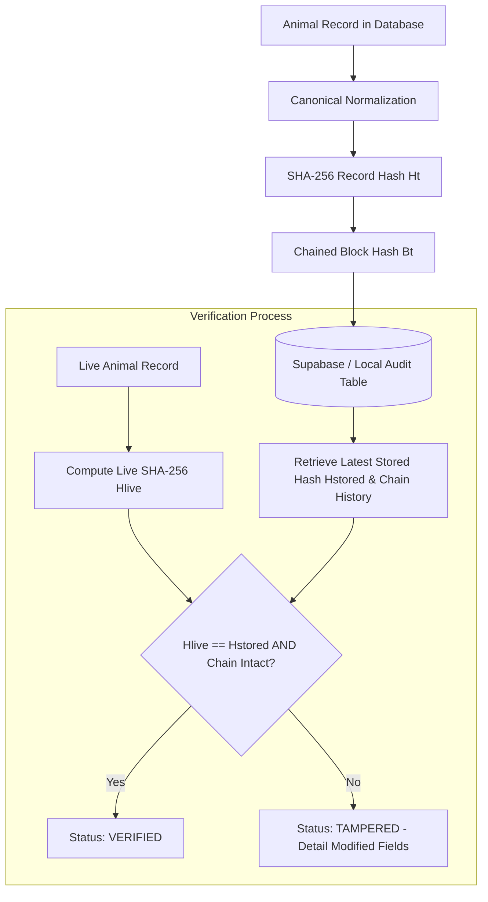

# PashuVision Tamper-Evident Record Verification

## 1. Overview & Technical Honesty

PashuVision features a **Cryptographic Tamper-Evident Record Verification System** designed to ensure the integrity, immutability, and traceability of livestock records.

### Technical Honesty Disclosure
- **Not a Public Proof-of-Work / Proof-of-Stake Network**: PashuVision does not run a simulated in-memory blockchain miner or claim false on-chain transactions on Ethereum or Polygon.
- **Cryptographic Audit Architecture**: The system uses **deterministic canonical JSON serialization**, **SHA-256 cryptographic hashing**, and **cryptographically linked block chains** stored persistently in PostgreSQL (Supabase) with local JSON fallback.
- **Optional External Network Adapter**: A clean `PolygonEthereumAdapter` interface is provided as an optional plug-in for when an organization deploys a dedicated smart contract to anchor state roots on public EVM networks.

---

## 2. Architecture & Verification Flow

The record verification pipeline operates as follows:



### 2.1 Canonical JSON Serialization
Standard JSON serialization does not guarantee key ordering:
```json
// Object 1: {"id": "1", "breed": "Gir"}
// Object 2: {"breed": "Gir", "id": "1"}
```
Although semantically identical, naive hashing produces two completely different SHA-256 hashes.

PashuVision solves this via `toCanonicalJson()` in [BlockchainService.js](file:///c:/Users/akeem/Downloads/PashuVision-main/PashuVision-main/backend/src/services/BlockchainService.js):
1. **Attribute Normalization**: Extracts core zootechnical, ownership, and identification fields (`id`, `earTag`, `species`, `predictedBreed`, `ownerName`, `location`, `ageMonths`, `gender`, `status`, `healthStatus`, `vaccinationStatus`, `weight`).
2. **Key Sorting**: Deterministically sorts all object keys in lexicographical order.
3. **Whitespace Stripping**: Eliminates arbitrary indentation and formatting spaces.
4. **Exclusion of Volatile Metadata**: Excludes dynamic runtime timestamps (e.g. `lastVerifiedAt`) to prevent false positives.

### 2.2 SHA-256 Hashing & Chaining Formula
1. **Record Hash ($H_t$)**:
   $$H_t = \text{SHA256}(\text{CanonicalJson}(\text{AnimalRecord}_t))$$
2. **Chain Hash ($B_t$)**:
   $$B_t = \text{SHA256}(H_t \parallel B_{t-1} \parallel \text{operation} \parallel \text{timestamp} \parallel \text{actorId})$$
   - Where $B_0 = 0^{64}$ (64 zeroes, the Genesis Hash).
   - $\parallel$ represents delimiter-separated string concatenation.

---

## 3. Database Schema & Migration

The persistent audit chain is stored in the `record_audit_log` table:

```sql
CREATE TABLE IF NOT EXISTS record_audit_log (
  id UUID PRIMARY KEY DEFAULT gen_random_uuid(),
  animal_id TEXT NOT NULL,
  operation TEXT NOT NULL, -- 'CREATE', 'UPDATE', 'APPROVE', 'REJECT', 'FLAG'
  record_hash TEXT NOT NULL, -- SHA-256 of canonical animal record attributes
  previous_hash TEXT, -- SHA-256 chain hash of previous audit record
  chain_hash TEXT NOT NULL, -- Cryptographic block link
  actor_id TEXT NOT NULL, -- User/admin responsible for operation
  timestamp TIMESTAMPTZ NOT NULL DEFAULT NOW(),
  canonical_snapshot JSONB NOT NULL, -- Snapshot for tamper field diff
  metadata JSONB DEFAULT '{}'::jsonb
);

-- Query performance indexes
CREATE INDEX IF NOT EXISTS idx_audit_animal_id ON record_audit_log(animal_id);
CREATE INDEX IF NOT EXISTS idx_audit_timestamp ON record_audit_log(timestamp DESC);
CREATE INDEX IF NOT EXISTS idx_audit_chain_hash ON record_audit_log(chain_hash);
```

### Row Level Security (RLS)
- **Public & Authenticated Read**: Allows verifying QR certificates and viewing audit logs.
- **Append-Only Inserts**: Strictly controlled through the authenticated backend service.
- **No Updates or Deletes**: Records in `record_audit_log` cannot be altered or deleted.

---

## 4. API Endpoints

### 4.1 Verify Animal Record
`GET /api/blockchain/animal/:id/verify`

**Response (Verified)**:
```json
{
  "status": "VERIFIED",
  "verified": true,
  "animalId": "animal-123",
  "currentHash": "e0aab166df...",
  "storedHash": "e0aab166df...",
  "chainValid": true,
  "totalAuditRecords": 2,
  "lastOperation": "APPROVE",
  "lastAuditedAt": "2026-09-19T10:15:00Z",
  "actorId": "admin-user-id",
  "verificationTimestamp": "2026-09-19T10:30:00Z",
  "message": "Cryptographic integrity confirmed. Record exactly matches the tamper-evident audit chain."
}
```

**Response (Tampered)**:
```json
{
  "status": "TAMPERED",
  "verified": false,
  "animalId": "animal-123",
  "currentHash": "f789abc...",
  "storedHash": "e0aab166df...",
  "chainValid": true,
  "tamperDetails": {
    "reason": "Record attributes have been altered without an authorized audit chain transaction",
    "modifiedFields": [
      {
        "field": "ownerName",
        "storedValue": "Sunita Sharma",
        "currentValue": "Malicious Actor"
      },
      {
        "field": "predictedBreed",
        "storedValue": "Gir",
        "currentValue": "Sahiwal"
      }
    ]
  },
  "warning": "SECURITY ALERT: This record failed tamper verification. Stored SHA-256 hash does not match current state."
}
```

### 4.2 Animal Audit History
`GET /api/blockchain/animal/:id/history`

Returns the chronological audit trail with sequence index, operation, record hash, chain hash, previous hash, timestamp, actor ID, and snapshot.

### 4.3 Cryptographic Certificate
`GET /api/blockchain/animal/:id/certificate`

Returns a digitally verifiable authenticity certificate with a cryptographic SHA-256 certificate signature.

### 4.4 System Verification Stats
`GET /api/blockchain/stats`

Returns total audited records, unique animals, operations breakdown, and explicit technical disclosure confirming non-public blockchain architecture.

---

## 5. Security Model & Limitations

| Guarantee | Status | Explanation |
|---|---|---|
| **Tamper Detection** | **Guaranteed** | Any modification to record fields without an authorized audit chain transaction changes the SHA-256 hash and immediately flags `TAMPERED`. |
| **Audit Traceability** | **Guaranteed** | Every lifecycle event (`CREATE`, `UPDATE`, `APPROVE`, `REJECT`, `FLAG`) records the actor ID, timestamp, and hash snapshot. |
| **Key Invariance** | **Guaranteed** | Canonical JSON ordering ensures identical attributes always yield identical hashes. |
| **Decentralized Censorship Resistance** | **Limitation** | Database records reside in PostgreSQL/Supabase. A database superuser with raw SQL access could theoretically wipe rows unless anchored to an external public blockchain. |
| **Public Consensus** | **Optional** | Requires invoking `PolygonEthereumAdapter` with an active Web3 wallet and deployed smart contract. |

---

## 6. Optional Polygon / Ethereum External Adapter

Located in [BlockchainIntegrationService.js](file:///c:/Users/akeem/Downloads/PashuVision-main/PashuVision-main/frontend/src/services/BlockchainIntegrationService.js):

```javascript
import { PolygonEthereumAdapter } from './services/BlockchainIntegrationService';

// Optional: Anchor hash to Polygon POS testnet or mainnet
const adapter = new PolygonEthereumAdapter({
  contractAddress: '0xYourContractAddressHere',
  rpcUrl: 'https://polygon-rpc.com',
  chainId: '137'
});

if (adapter.isAvailable()) {
  await adapter.anchorHashToNetwork({ animalId, recordHash });
}
```

---

## 7. Verification Tests

Run the automated test suite to verify canonical determinism, audit anchoring, and tamper detection:

```bash
node backend/tests/test_record_verification.js
```
